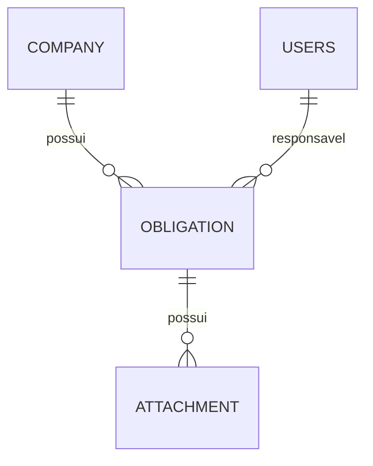

# Modelo de domínio e persistência

Esta referência resume `docs/modelo-de-dados.md`. Se houver diferença, inspecione migrations e alinhe a documentação antes de alterar o modelo.

## Relações

- `Company` → tabela `company`.
- `Responsible` → tabela `users`.
- `Obligation` → tabela `obligation`.
- `Attachment` → tabela `attachment`.

## Campos documentados

| Entidade | Campos principais | Restrições relevantes |
|---|---|---|
| Company | `id`, `legal_name`, `trade_name`, `cnpj`, `active`, `created_at`, `updated_at` | CNPJ único, 14 dígitos normalizados; `active` default true |
| Responsible | `id`, `name`, `email`, `password`, `active`, `created_at`, `updated_at` | e-mail único, normalizado; senha armazenada como hash; `active` default true |
| Obligation | `id`, `company_id`, `responsible_id`, `title`, `description`, `status`, `due_date`, `completed_at`, `created_at`, `updated_at` | FKs obrigatórias; status default `PENDING`; `due_date` obrigatório; CHECK dos três estados |
| Attachment | `id`, `obligation_id`, `file_name`, `file_path`, `content_type`, `file_size`, `uploaded_at` | FK obrigatória para obligation |

## Regras de mapeamento
- FKs de `Obligation` são `ManyToOne(fetch = LAZY, optional = false)`.
- Não adicione `OneToMany` com cascata de remoção ou `orphanRemoval`.
- `Responsible.passwordHash` mapeia a coluna `users.password`.
- `Attachment.storageKey` mapeia `attachment.file_path`.
- `completed_at` começa nulo e é preenchido na conclusão.
- FKs não usam `ON DELETE CASCADE`.
- Índices documentados: `obligation(company_id)`, `obligation(responsible_id)`, `obligation(status, due_date)` e `attachment(obligation_id)`.
- Constraints únicas: `uk_company_cnpj` e `uk_users_email`.

## Observações
- `due_date` é `NOT NULL` no modelo/API documentados.
- A tabela física é `users`, embora o conceito de domínio/API seja `Responsible`.
- Use migrations existentes como fonte para DDL real; não copie cegamente exemplos antigos.
