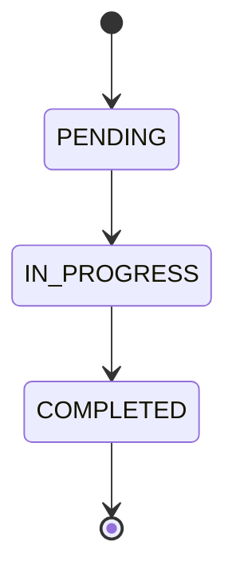

# Ciclo de vida da obrigação

| Origem | Destino | Resultado |
|---|---|---|
| PENDING | IN_PROGRESS | Permitido |
| PENDING | COMPLETED | Rejeitado |
| IN_PROGRESS | COMPLETED | Permitido |
| IN_PROGRESS | PENDING | Rejeitado |
| COMPLETED | qualquer estado | Rejeitado |
| qualquer estado | mesmo estado | Rejeitado |

## Regras
1. Nova obrigação recebe `PENDING` no servidor.
2. Somente `PENDING → IN_PROGRESS → COMPLETED`.
3. `COMPLETED` é terminal.
4. Ao concluir, preencher `completedAt`/`completed_at`.
5. Uma transição rejeitada não altera status nem data de conclusão.
6. A validação da transição deve ocorrer no domínio/serviço; o CHECK do banco apenas restringe valores possíveis.

## API
A documentação atual expõe `PATCH /api/obligations/{id}/status`. Também documenta status opcional no `PUT /api/obligations/{id}`. Não assuma que os dois contratos são equivalentes em todos os detalhes; preserve os testes e o comportamento real. Resposta de transição inválida: HTTP 422, `INVALID_STATUS_TRANSITION`, conforme `docs/api.md`.

## Testes mínimos
- Duas transições permitidas e transições proibidas.
- Transição para o mesmo status.
- `completedAt` nulo antes da conclusão e preenchido ao concluir.
- Falha não altera status nem `completedAt`.
