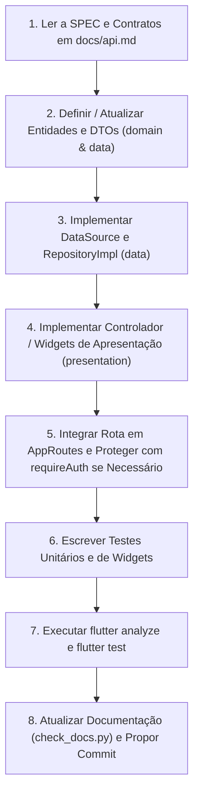

# Skill — Gestão de Obrigações Fiscais (Frontend Flutter)

Use esta Skill para planejar, implementar, refatorar, depurar e testar qualquer funcionalidade no frontend Flutter (`frontend/`).
Esta Skill complementa a `gestao-obrigacoes-fiscais` (focada no backend Spring Boot) e orienta a entrega de interfaces organizadas, componentizadas, testáveis e estritamente aderentes aos contratos e diretrizes do projeto.

---

## Antes de Agir

1. **Consulte as Rules do Projeto:**
   - **Regra 04 (`04-confirmacao-obrigatoria-de-commits.md`):** NUNCA execute `git commit` ou `git push` sem confirmação e aprovação explícita do usuário.
   - **Regra 05 (`05-desenvolvimento-frontend-baseado-em-documentacao.md`):** NUNCA inspecione, pesquise ou leia código em `backend/src/**`. Toda decisão no frontend deve se basear exclusivamente em `docs/api.md`, `docs/arquitetura.md`, `docs/modelo-de-dados.md` e nas especificações (`.agent/docs/specs/`).
   - **Regra 03 (`03-documentacao-atualizada.md`):** Ao concluir qualquer funcionalidade ou SPEC, mantenha a documentação sincronizada e execute o script de validação (`check_docs.py`).
2. **Consulte os Documentos de Referência desta Skill:**
   - `references/architecture-guide.md`: Padrão *Feature-First* + *Clean Architecture*, injeção de dependências e design system.
   - `references/api-integration-guide.md`: Comunicação com a API, autenticação JWT, tratamento de `ApiException` e paginação.
   - `references/business-rules-frontend.md`: Regras de negócio refletidas na UI (RN-001 a RN-009).
   - `references/testing-guide.md`: Padrões de testes unitários e de widgets, fake repositories e prevenção contra secret scanning.
3. **Inspecione o Estado Atual do Frontend:**
   - Verifique `frontend/pubspec.yaml`, `frontend/lib/core/` e os módulos em `frontend/lib/features/`.
   - Consulte `docs/status-implementacao.md` e a SPEC correspondente em `.agent/docs/specs/`.

---

## Stack Tecnológica do Frontend

- **Linguagem & Framework:** Dart 3.7+ / Flutter 3.29+
- **Design System:** Material 3 com paleta corporativa institucional (Deep Blue `#1E3A8A` e Teal `#0D9488`).
- **Arquitetura:** *Feature-First* combinada com *Clean Architecture* (`data`, `domain`, `presentation`).
- **Gerenciamento de Estado:** `ChangeNotifier` / `AnimatedBuilder` para controladores de sessão e formulários estatais com `StatefulWidget`.
- **Roteamento:** Rotas nomeadas centralizadas em `AppRoutes`.
- **Comunicação HTTP:** `ApiClient` desacoplado baseado no pacote `http`, com suporte a timeouts, Bearer JWT, `multipart/form-data` e streaming binário.
- **Persistência de Sessão:** Abstração `AuthSessionStorage` (`SecureAuthSessionStorage` via `flutter_secure_storage` em produção e `InMemoryAuthSessionStorage` para testes automatizados).
- **Testes:** `flutter_test` (testes unitários e widget tests com `WidgetTester`).

---

## Sequência Recomendada de Desenvolvimento

1. **Entenda os Contratos e Regras:**
   - Consulte `docs/api.md` para endpoints, payloads, parâmetros de query e códigos de erro.
   - Não invente payloads ou campos que não existam no contrato.
2. **Estruture por Camadas (Clean Architecture):**
   - **`domain`:** Entidades puras e contratos de repositório (`Repository`).
   - **`data`:** DTOs (Request/Response), `RemoteDataSource` e `RepositoryImpl`.
   - **`presentation`:** Páginas, diálogos, formulários e controladores.
   - **Regra de Ouro:** A camada de apresentação **NUNCA** faz chamadas HTTP diretas; interage unicamente com o `Repository` ou `Controller`.
3. **Resiliência e Deserialização Segura:**
   - Converta identificadores numéricos com `(json['id'] as num).toInt()`.
   - Suporte mapeamentos tolerantes para respostas de login (`user` e `responsible`, `token` e `accessToken`).
   - Datas nulas ou parciais devem utilizar `DateTime.tryParse(...)`.
4. **Tratamento Semântico de Erros:**
   - Trate erros previsíveis da API via `ApiException` (`VALIDATION_ERROR`, `DUPLICATE_*`, `INVALID_STATUS_TRANSITION`, `COMPANY_INACTIVE`, etc.).
   - Mantenha mensagens amigáveis na UI, exibindo erros junto aos campos correspondentes sempre que houver `details`.
5. **Autenticação e Leitura Anônima:**
   - A navegação por listagens e consultas é **anônima** por padrão (AUTH-01).
   - Operações de mutação (criação, edição, alteração de status) e manipulação de anexos exigem autenticação via `requireAuth(context, authController: ...)`.
   - Intercepte `401 UNAUTHORIZED` em chamadas autenticadas limpando a sessão e avisando o usuário.
6. **Escreva e Execute Testes:**
   - Testes unitários para models, DTOs e controladores.
   - Testes de widgets para telas, formulários, validações inline, estados vazios/erro e guards.
   - Utilize `InMemoryAuthSessionStorage` nos testes para evitar dependência de plugins nativos de plataforma em ambientes de teste.
   - **Atenção:** Em testes, use helpers para gerar senhas e tokens simulados (evitando falsos positivos em ferramentas de *secret scanning*).
7. **Validação Final e Governança:**
   - `cd frontend; flutter analyze` (0 erros).
   - `cd frontend; flutter test` (100% de aprovação).
   - `python .agent/skills/documentacao-projeto/scripts/check_docs.py .` (consistência documental).
   - Apresente o resumo e a mensagem de commit ao usuário para aprovação formal (Regra 04).

---

## Critérios de Qualidade e Aceite

- **Navegação Intuitiva:** Telas responsivas adaptando-se via `AppScaffold` entre desktop/web e mobile.
- **Feedback Visual Completo:** Todos os fluxos assíncronos devem contemplar estados de `LoadingStateView`, `ErrorStateView` (com retry) e `EmptyStateView`.
- **Formulários Robustos:** Validações síncronas inline antes de enviar à API, bloqueio de múltiplos envios (botão desabilitado com indicador de progresso) e máscara de campos sensíveis.
- **Respeito à Máquina de Estados (RN-008):** Apenas transições válidas devem ser oferecidas ao usuário na interface (`PENDING -> IN_PROGRESS -> COMPLETED`).
- **Sem Exclusão Física (RN-004):** A UI oferece inativação lógica via switch/toggle, nunca botões de exclusão física permanente.
- **Segurança (RN-007):** Senhas nunca são mantidas em texto puro nem gravadas em logs; o token Bearer é transmitido em cabeçalho seguro.

