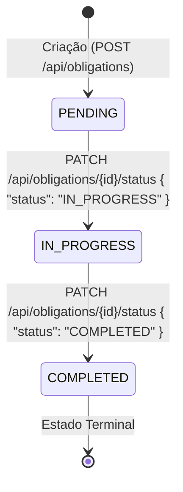

# Regras de Negócio do Domínio no Frontend

Este documento descreve as regras de negócio oficiais (RN-001 a RN-009) do sistema e como elas devem ser refletidas na interface do usuário e nas validações do cliente Flutter.

---

## RN-001: Validação e Formatação de CNPJ
- **Algoritmo de Dígitos Verificadores:** O cliente utiliza `CnpjValidator` para calcular e verificar os dígitos verificadores (DV1 e DV2) segundo a regra da Receita Federal.
- **Normalização:** Caracteres não numéricos (pontos, traços e barras) são descartados antes do envio para a API (`cnpj.replaceAll(RegExp(r'\D'), '')`).
- **Sequências Repetidas:** Combinações repetidas (ex.: `00000000000000`, `11111111111111`) são rejeitadas na validação inline.
- **Formatação na Interface:** O CNPJ é apresentado ao usuário no formato visual padrão: `XX.XXX.XXX/XXXX-XX`.

---

## RN-002 e RN-003: Unicidade de CNPJ e E-mail
- **Validação pelo Backend:** O backend é a autoridade sobre unicidade no banco de dados.
- **Tratamento de Conflito no Cliente:**
  - Tentativa de cadastrar CNPJ repetido resulta em `409 DUPLICATE_CNPJ`: o formulário deve exibir a mensagem sob o campo de CNPJ sem resetar o formulário.
  - Tentativa de cadastrar e-mail repetido resulta em `409 DUPLICATE_EMAIL`: o formulário de responsável ou autocadastro deve alertar que o e-mail já está em uso.

---

## RN-004: Proibição de Exclusão Física (Soft Delete)
- **Sem Exclusão Física:** Em conformidade com a ADR-0001, o sistema não realiza `DELETE` físico de empresas, responsáveis, obrigações ou histórico.
- **Comportamento na UI:**
  - **NUNCA** adicione botões de "Excluir", "Deletar" ou ícones de lixeira (`Icons.delete`) com chamadas de remoção física.
  - O encerramento ou inativação cadastral é realizado exclusivamente através do campo `active` (switch ou toggle de Situação Cadastral: "Ativo" / "Inativo") via requisição `PUT`.
  - Telas de listagem oferecem chips de filtro rápido para alternar entre registros "Todos", "Ativos" e "Inativos".

---

## RN-005: Preservação de Histórico Fiscal
- O histórico fiscal é preservado. Empresas ou responsáveis vinculados a obrigações permanecem no histórico mesmo se inativados.

---

## RN-006: Bloqueio de Atribuição a Inativos
- **Seletores no Cadastro de Obrigações:**
  - Ao abrir o formulário de cadastro de nova obrigação, os seletores suspensos (dropdowns) de Empresa e de Responsável devem carregar e permitir a seleção **somente de registros ativos** (`active: true`).
- **Na Edição de Obrigação:**
  - Caso a obrigação já tenha sido criada com uma empresa/responsável que posteriormente foi inativado, a exibição mantém os dados históricos, mas qualquer alteração deve exigir a seleção de entidades ativas.

---

## RN-007: Segurança de Senhas e Credenciais
- **Senhas Ocultas:** A senha é transmitida em texto claro apenas nas rotas públicas `POST /api/auth/login` e `POST /api/auth/register`, e na rota restrita `POST /api/responsibles`.
- **Nunca Exibir ou Retornar Senhas:** O frontend **nunca** loga senhas, nunca armazena senhas em texto puro e nunca espera receber senha em DTOs de consulta (`GET /api/responsibles/**` e `ResponsibleResponse` não contêm senha).
- **Máscara e Alternância:** Campos de senha devem utilizar `obscureText: true` por padrão com botão de alternância de visibilidade (ícone de olho).
- **Validação de Tamanho:** A senha deve conter no mínimo 6 caracteres e no máximo 100 caracteres.

---

## RN-008: Ciclo de Vida e Máquina de Estados da Obrigação
A obrigação fiscal segue estritamente o ciclo de vida:

- **Estado Inicial:** Toda nova obrigação nasce obrigatoriamente no status inicial `PENDING` (definido pelo backend). O formulário de criação não deve permitir escolha de status.
- **Transições Permitidas:**
  - `PENDING -> IN_PROGRESS` (Ação na UI: "Iniciar Execução").
  - `IN_PROGRESS -> COMPLETED` (Ação na UI: "Concluir Obrigação").
- **Bloqueios Rígidos na Interface:**
  - A interface deve apresentar apenas a **próxima transição válida**.
  - Não permitir reabertura de obrigação concluída (`COMPLETED` é estado terminal definitivo).
  - Não permitir pular etapas (`PENDING -> COMPLETED` diretamente).
  - Quando a obrigação estiver `COMPLETED`, os botões de alteração de status são desabilitados/ocultados, exibindo a data de conclusão (`completedAt`).

---

## RN-009: Gestão e Armazenamento de Anexos
- **Metadados:** Cada anexo possui `id`, `originalFilename`, `contentType`, `sizeBytes`, `sizeFormatted` (ex.: `2.4 MB`, `180 KB`) e `uploadedAt`.
- **Upload Multipart:** Envio realizado através de `multipart/form-data` no campo `file` para `POST /api/obligations/{id}/attachments`.
- **Limite de Tamanho:** Tamanho máximo aceito de 10 MB. O cliente deve validar previamente o tamanho do arquivo selecionado e avisar o usuário se exceder o limite.
- **Download Seguro:** Consome `GET /api/attachments/{id}/download`, extrai o nome de arquivo do cabeçalho `Content-Disposition` e despacha para salvamento/abertura no dispositivo.
- **Autenticação:** Todas as ações de anexos exigem token Bearer JWT.

