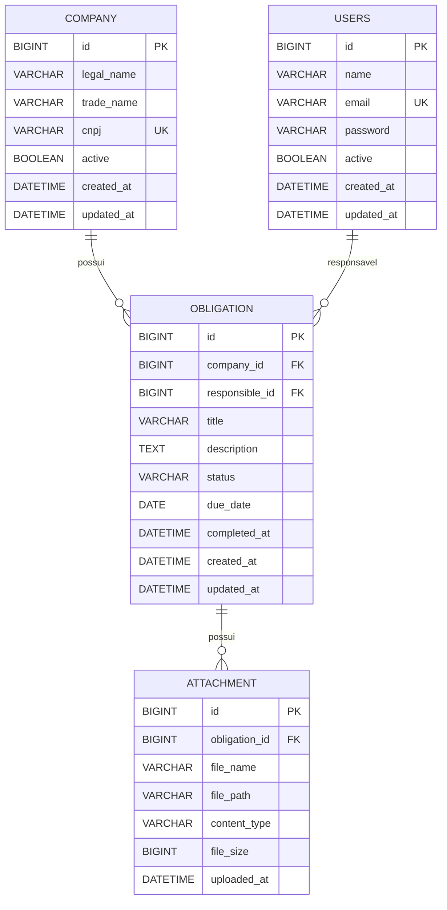

# Modelo de dados

> Derivado das migrations em `src/main/resources/db/migration`. Última migration considerada: `V2__align_domain_names.sql`.

## Diagrama ER

A tabela de usuários chama-se `users` (no plural) para evitar conflito com palavra reservada no MySQL/ANSI SQL.

---

## Tabelas

### `company`
Representa as empresas clientes gerenciadas no sistema contábil.

| Coluna | Tipo | Nulo | Restrições | Descrição |
|---|---|---|---|---|
| `id` | `BIGINT` | Não | PK, `AUTO_INCREMENT` | Identificador único da empresa |
| `legal_name` | `VARCHAR(255)` | Não | — | Razão social |
| `trade_name` | `VARCHAR(255)` | Sim | — | Nome fantasia |
| `cnpj` | `VARCHAR(14)` | Não | `uk_company_cnpj` (UNIQUE) | CNPJ normalizado (somente os 14 dígitos) |
| `active` | `BOOLEAN` | Não | Padrão `TRUE` | Status para exclusão lógica (soft delete) |
| `created_at` | `DATETIME` | Não | Padrão `CURRENT_TIMESTAMP` | Data/hora de cadastro da empresa |
| `updated_at` | `DATETIME` | Não | Padrão `CURRENT_TIMESTAMP ON UPDATE CURRENT_TIMESTAMP` | Data/hora da última atualização |

- **Índices:**
  - `PRIMARY` em `id`
  - `uk_company_cnpj` (UNIQUE) em `cnpj`
- **Regras de integridade:**
  - Proibida duplicação de CNPJ (`uk_company_cnpj`).
  - Sem exclusão física (`DELETE`); a inativação é feita via campo `active = false`.
  - Não pode ser excluída fisicamente se houver obrigações vinculadas (FK `fk_obligation_company` sem cascade).

---

### `users`
Representa os colaboradores e responsáveis fiscais pelas obrigações (`Responsible`).

| Coluna | Tipo | Nulo | Restrições | Descrição |
|---|---|---|---|---|
| `id` | `BIGINT` | Não | PK, `AUTO_INCREMENT` | Identificador único do usuário |
| `name` | `VARCHAR(255)` | Não | — | Nome completo do usuário |
| `email` | `VARCHAR(255)` | Não | `uk_users_email` (UNIQUE) | E-mail corporativo único, minúsculo e sem espaços |
| `password` | `VARCHAR(255)` | Não | — | Hash seguro da senha (BCrypt/Argon2) |
| `active` | `BOOLEAN` | Não | Padrão `TRUE` | Status de ativação do usuário |
| `created_at` | `DATETIME` | Não | Padrão `CURRENT_TIMESTAMP` | Data/hora de cadastro |
| `updated_at` | `DATETIME` | Não | Padrão `CURRENT_TIMESTAMP ON UPDATE CURRENT_TIMESTAMP` | Data/hora da última atualização |

- **Índices:**
  - `PRIMARY` em `id`
  - `uk_users_email` (UNIQUE) em `email`
- **Regras de integridade:**
  - Proibida duplicação de e-mail (`uk_users_email`).
  - Sem exclusão física (`DELETE`); inativação via `active = false`.
  - Não pode ser excluído fisicamente se for responsável por obrigações existentes (FK `fk_obligation_responsible` sem cascade).

---

### `obligation`
Representa as obrigações fiscais atribuídas a empresas e sob responsabilidade de um `Responsible`.

| Coluna | Tipo | Nulo | Restrições | Descrição |
|---|---|---|---|---|
| `id` | `BIGINT` | Não | PK, `AUTO_INCREMENT` | Identificador único da obrigação |
| `company_id` | `BIGINT` | Não | FK `fk_obligation_company` | Empresa associada à obrigação |
| `responsible_id` | `BIGINT` | Não | FK `fk_obligation_responsible` | Usuário responsável pela execução |
| `title` | `VARCHAR(255)` | Não | — | Título da obrigação (ex.: DCTF, ECF, DEFIS) |
| `description` | `TEXT` | Sim | — | Detalhes e instruções complementares |
| `status` | `VARCHAR(20)` | Não | Padrão `'PENDING'`, `ck_obligation_status` | Status do ciclo de vida |
| `due_date` | `DATE` | Não | — | Data limite de entrega da obrigação |
| `completed_at` | `DATETIME` | Sim | — | Data/hora de conclusão (preenchido ao atingir `COMPLETED`) |
| `created_at` | `DATETIME` | Não | Padrão `CURRENT_TIMESTAMP` | Data/hora de criação |
| `updated_at` | `DATETIME` | Não | Padrão `CURRENT_TIMESTAMP ON UPDATE CURRENT_TIMESTAMP` | Data/hora da última alteração |

- **Índices:**
  - `PRIMARY` em `id`
  - `idx_obligation_company` em `(company_id)`
  - `idx_obligation_responsible` em `(responsible_id)`
  - `idx_obligation_status_due` em `(status, due_date)`
- **Regras de integridade:**
  - `ck_obligation_status`: `status IN ('PENDING', 'IN_PROGRESS', 'COMPLETED')`.
  - FK `fk_obligation_company` referencia `company(id)` (sem `ON DELETE CASCADE`).
  - FK `fk_obligation_responsible` referencia `users(id)` (sem `ON DELETE CASCADE`).
  - `completed_at` inicia nulo e é preenchido somente na conclusão.
  - `status` é controlado pelo domínio; somente `PENDING → IN_PROGRESS → COMPLETED` é permitido.

---

## Mapeamento JPA

- `Company.legalName` → `company.legal_name`; `tradeName` → `company.trade_name`.
- `Responsible` → `users`; `passwordHash` → `password` (hash seguro gerado com BCrypt via Spring Security).
- `Attachment.name`, `contentType`, `size`, `storageKey` e `uploadedAt` → `file_name`, `content_type`, `file_size`, `file_path` e `uploaded_at`.
- Relações para pais usam `ManyToOne(fetch = LAZY, optional = false)`; não há `OneToMany`, cascata de remoção ou `orphanRemoval`.

---

### `attachment`
Metadados de arquivos comprobatórios anexados a uma obrigação fiscal.

| Coluna | Tipo | Nulo | Restrições | Descrição |
|---|---|---|---|---|
| `id` | `BIGINT` | Não | PK, `AUTO_INCREMENT` | Identificador único do anexo |
| `obligation_id` | `BIGINT` | Não | FK `fk_attachment_obligation` | Obrigação fiscal à qual o anexo pertence |
| `file_name` | `VARCHAR(255)` | Não | — | Nome original do arquivo enviado pelo usuário |
| `file_path` | `VARCHAR(500)` | Não | — | Localização segura no storage/filesystem |
| `content_type` | `VARCHAR(100)` | Não | — | MIME Type do arquivo (ex.: `application/pdf`) |
| `file_size` | `BIGINT` | Não | — | Tamanho do arquivo em bytes |
| `uploaded_at` | `DATETIME` | Não | Padrão `CURRENT_TIMESTAMP` | Data/hora em que o upload foi concluído |

- **Índices:**
  - `PRIMARY` em `id`
  - `idx_attachment_obligation` em `(obligation_id)`
- **Regras de integridade:**
  - FK `fk_attachment_obligation` referencia `obligation(id)` (sem `ON DELETE CASCADE`).
  - Todo anexo deve estar estritamente vinculado a uma obrigação existente.
